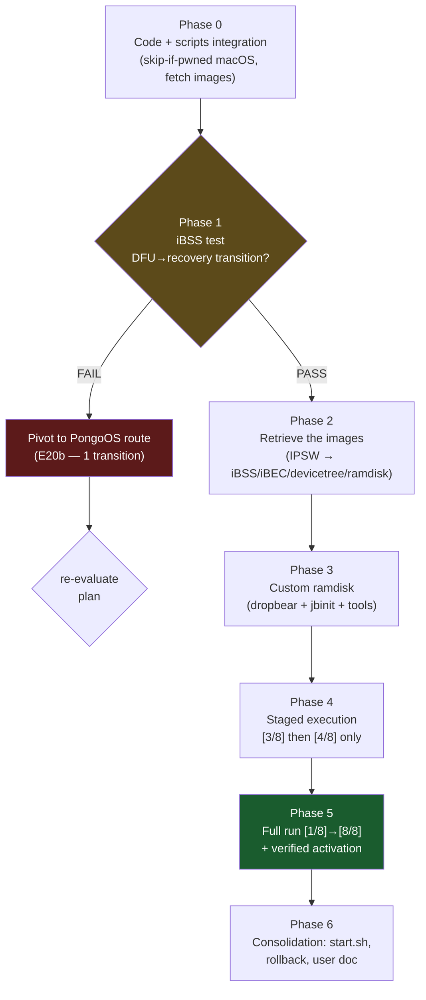

# Execution plan — after checkm8 (Path A)

> Part of the [documentation index](README.md).

> **Context**: the checkm8 stage is proven on this machine (E19,
> `PWND:[checkm8]`, direct USB-C cable without a hub). Steps [3/8]→[8/8]
> of the pipeline (`path_a_ramdisk` → `path_a_deliver` → … → `activation_is_activated`,
> ~2980 lines) are written but **have never run**. This plan moves them
> from "written" to "executed", in phases with decision gates.
>
> Companion docs:
> [`palera1n-comparison.md`](palera1n-comparison.md)
> (routes) · [`apple-silicon-usbc/`](apple-silicon-usbc/README.md)
> (E0→E20b log).

---

## Overview



**Guiding principle**: every phase has a **measurement gate** — we
never move forward on an assumption. The first failure at a gate
leads to the documented decision (pongoOS pivot or targeted debugging),
not to improvisation.

---

## Phase 0 — Code + scripts integration (no device required)

Goal: everything that can be made "agent-free, scriptable"
is, and re-runs are safe.

| # | Task | File | Acceptance criterion |
|---|---|---|---|
| 0.1 | **Skip-if-pwned on macOS**: the fast path `checkm8_verify_pwned()==1 → skip` is behind `#if !defined(__APPLE__)`. Port it to Apple (IOKit serial read, without touching EP0) so that `./tr4mpass` is safely re-entrant. | `src/exploit/checkm8.c` | 2nd consecutive run on a pwned device: log `already processed, skipping`, 0 USB requests written. |
| 0.2 | **`scripts/fetch_images.sh`**: orchestrates `ipsw_pull.py` for iBSS/iBEC/devicetree/ramdisk/trustcache from the IPSW of the detected version; writes the paths into an env file ready to `source`. | `scripts/` (new) | A `source env` provides the 4 `TR4MPASS_*_PATH` variables non-empty, files non-empty. |
| 0.3 | **`scripts/run_path_a.sh`**: assembles the env (`TR4MPASS_*`) then runs `./tr4mpass -v` with timestamped `tee`; captures the exit code; prints the final serial. | `scripts/` (new) | The script refuses to run if a required `TR4MPASS_*` is missing (message listing the missing ones). |
| 0.4 | **Staged execution**: variable `TR4MPASS_STOP_AFTER=<n>` read by `path_a_execute` to stop after step n (default 8). Makes it possible to validate [3/8]+[4/8] without touching `mobileactivationd`. | `src/bypass/path_a.c` | `STOP_AFTER=4`: steps 5-8 are neither logged nor executed; exit 0. |
| 0.5 | Verify build/tests after each change (`make`, `make test` 62/62). | — | 0 warning, 62/62. |

**Deliverable**: everything committed on `fix/library-usage-audit`, scripts
executable, usage doc at the top of each script.

---

## Phase 1 — Discriminating measurement: iBSS test ⏸ *device required*

Goal: settle the **only** remaining technical question — do post-pwn USB
transitions survive the direct USB-C cable?

**Scripts**: already written (`scripts/ramdisk_test_ibss.sh`,
`scripts/detect_ios.sh`, `scripts/ipsw_pull.py`). Two passes:

```sh
# Pass 1 — consumes the current pwned state, detects iOS, pulls the iBSS
scripts/ramdisk_test_ibss.sh
# … then back to DFU (buttons) + re-pwn:
./tr4mpass -v
# Pass 2 — detection from cache: iBSS upload + PID 0x1281 monitoring
scripts/ramdisk_test_ibss.sh
```

| Result | Decision |
|---|---|
| `PASS` (PID 0x1281 observed, without replug) | → **Phase 2** (IPSW route confirmed) |
| `FAIL` (no transition within 60 s) | → pivot to **PongoOS route** (E20b): integrate `libopenra1n` (MIT) + `yolo_s8000.bin` — 1 transition only; re-plan required before Phase 2 |

**Evidence to archive**: timestamped log in `/tmp/`, E21 entry in the
research log.

---

## Phase 2 — Retrieve the images (⏸ after Phase 1 gate = PASS)

Goal: assemble, from the IPSW **of the installed version**, everything
that `path_a_ramdisk.c` requires.

| Image | Env variable | Extraction | Expected size |
|---|---|---|---|
| iBSS (`iBSS.<board>.im4p`) | `TR4MPASS_IBSS_PATH` | Range-request (~200 KB) | ~200 KB |
| iBEC (`iBEC.<board>.im4p`) | `TR4MPASS_IBEC_PATH` | Range-request | ~250 KB |
| DeviceTree (`DeviceTree.<board>.im4p`) | `TR4MPASS_DEVICETREE_PATH` | Range-request | ~100 KB |
| Ramdisk | `TR4MPASS_RAMDISK_PATH` | Range-request | ~20-60 MB |
| Trustcache (iOS 14+ only) | `TR4MPASS_TRUSTCACHE_PATH` | optional | — |

```sh
scripts/fetch_images.sh            # → writes ~/.cache/tr4mpass/images/env.sh
source ~/.cache/tr4mpass/images/env.sh
```

**Honesty notes**:
- If a device has several board variants (for example a dual-sourced SoC), all variants are fetched and exported as `_ALT`; the
  device chooses via BDID; `fetch_images.sh` pulls both.
- The **stock ramdisk** is not enough for Phase 3 (see below);
  we retrieve it anyway: it serves as the patching base.

**Gate**: `file` non-empty + checksums recorded in the log.

---

## Phase 3 — Custom ramdisk (the biggest job outside code)

> **Permanent principle (user directive)**: before writing anything at
> all, check that an existing tool does not already do the step. Mapping
> table below — each row = an existing tool, not new
> code.

Goal: the ramdisk must contain what `path_a` assumes is present:
**dropbear on 2222**, **`/usr/bin/jbinit`** (AMFI patcher called by
`path_a_ssh.c`), basic POSIX tools. The IPSW ramdisk has none of that.

### 3.0 — Existing tools first (step → tool mapping)

| Plan step | Existing tool | Repo / source | Status |
|---|---|---|---|
| Download/extract IPSW | `ipsw` (MIT, Go, brew) | https://github.com/blacktop/ipsw | ✅ verified (`download ipsw --device --build`, `extract`, `mount rdisk`) — install: `brew install blacktop/tap/ipsw` |
| Build SSH ramdisk | ~~`ipsw ssh`~~ | https://blacktop.github.io/ipsw/docs/cli/ipsw/ssh/ssh | ❌ **verified: it is an SSH client**, not a builder. Subcommands = `debugserver`/`shsh` only. A hidden stub `idev restore-ramdisk` is `panic("not implemented")` |
| Prebuilt SSH ramdisk (option B) | Dora2 | github.com/dora2-iOS | ❌ **inactive account (0 repos)**, releases 404, `jbinit` 404 — dead option |
| Mount the stock ramdisk (patching aid) | `ipsw mount rdisk IPSW --ident Erase [--key K \| --lookup]` | https://blacktop.github.io/ipsw/docs/cli/ipsw/mount | ✅ verified — mounts on the host (no injection) |
| **Patched `mobileactivationd`** | *no known tool* | — | ❌ confirmed blocker (option B dead) |
| **[6/8] record + submission** | `ideviceactivation activate` (libideviceactivation, LGPL) | https://github.com/libimobiledevice/libideviceactivation | ✅ verified README: "Implements complete activation and deactivation process" + CLI. **Gate decision**: test it on the ramdisk device BEFORE our `path_a_activate` |
| Patch iBoot/dyld of the ramdisk | iBoot64Patcher, img4tool, iExtractor | already listed in README References | ✅ known — still required for option C |
| [7/8] deletescript | *no known equivalent* | — | ❌ tr4mpass code keeps it |

**Verified consequence (2026-11-01)**: option A (`ipsw ssh`) is dead,
option B (Dora2) is dead ⇒ **option C (manual pipeline:
`ipsw mount rdisk` → dropbear/jbinit injection → iBoot64Patcher →
img4tool/IMG4 rebuild) is the remaining path** — it is more work
than expected, and the `TR4MPASS_PATCHED_MAD` blocker remains entirely.
`scripts/build_ramdisk_ssh.sh` implements the runtime gate: if a future
`ipsw ssh ramdisk` appears, the script will use it; otherwise it fails
with the exact upgrade command (no workaround).

**Remaining major impact**: `ideviceactivation activate` (verified) can
replace our [6/8] C step for the first device run — our code
`activation/*.c` (modelled on this tool + go-ios, cf. README References)
remains the documented fallback. Watch the license if statically linked
(LGPL2.1 lib / GPL3 CLI — cf. the repo's COPYING).

| Option | Method | Cost | Risk |
|---|---|---|---|
| ~~A~~ | ~~`ipsw ssh`~~ — verified: SSH client, not a builder | — | ❌ dead (2026-11-01) |
| ~~B~~ | ~~Dora2 prebuilt~~ — verified: inactive account, releases 404 | — | ❌ dead (2026-11-01) |
| **C (only one left)** | Manual pipeline: `ipsw mount rdisk` (host mount of the RestoreRamDisk) → dropbear + tools injection → iBoot64Patcher (iBEC/iBoot) → img4tool (IMG4 repack) | high | several tools to chain; ramdisk decryption WKEY required (`ipsw` can look it up) |

**External input** (`TR4MPASS_PATCHED_MAD`) — see 3.0: IF a Dora2/hacktivation
ramdisk already bundles the patched binary, we retrieve it and
the blocker disappears. Otherwise, project decision: build it from
the cited libideviceactivation/go-ios sources, or obtain it elsewhere.

**Gate**: the custom ramdisk booted manually via
`irecovery -f` + `bootx` exposes SSH on 2222 (testable with `nc`/`ssh`
before integrating tr4mpass).

---

## Phase 4 — Staged execution (⏸ after Phase 3 gate)

Goal: run the genuinely new steps, one at a time.

```sh
source ~/.cache/tr4mpass/images/env.sh
export TR4MPASS_PATCHED_MAD=/path/to/mobileactivationd.patched

# Stage A: [1/8]+[2/8] (re-pwn) + [3/8] ramdisk + [4/8] patches — WITHOUT activation
scripts/run_path_a.sh --stop-after 4
```

| Stage | Validated steps | Success gate |
|---|---|---|
| A | pwn + ramdisk + kernel patches | SSH alive after `bootx`; `amfi-patch` logs OK |
| B | + [5/8] `mobileactivationd` replacement | `replace_mad: mobileactivationd replaced and verified` |
| C | + [6/8] record + [7/8] deletescript | `Activation record submitted`; Setup.app renamed |
| D | + [8/8] verification | `path_a: === Process successful -- device is activated ===` |

After each stage: note the device state (reboot? signal? screen?) in the
log. A failure at stage B/C/D leaves the device in a **recoverable**
state (classic restore possible at any time).

---

## Phase 5 — Full run

```sh
scripts/run_path_a.sh     # [1/8] → [8/8], one pass, timestamped logs
```

**Final criterion**: device booted on iOS, activated, **cellular signal
present**, and re-entry into Setup impossible. E2x "complete success"
entry in the log; README update (support table).

---

## Phase 6 — Consolidation

- `start.sh`: add "device already pwned" detection (-phase 0.1) and
  offer "resume the post-pwn pipeline" instead of re-pwn.
- Documented rollback (the device can always be restored via
  Finder/Apple Devices — note it at the top of the README).
- Update `COMPARISON-*.md`: fill in the "validation" column.
- Cleanup: remove the experimentation flags that have become useless
  (`TR4MPASS_SKIP_CLRSTATUS`, `TR4MPASS_PRE_STATUS`,
  `TR4MPASS_STAGE4_TIMEOUT_MS`) — or keep them with an E19 note.

---

## Risks and plan B (summary)

| Risk | Phase | Plan B |
|---|---|---|
| USB-C transition fails | 1 | PongoOS pivot (1 transition, E20b) |
| Custom ramdisk fails at boot | 3 | option B (prebuilt) then C (manual) |
| Patched `mobileactivationd` unavailable | 3-4 | identified blocker — project decision to be made |
| `mobileactivation_activate` rejects the record | 5 | debug via session logs (drmHandshake) — code already instrumented |
| Device reacts badly to AMFI patches | 4 | `STOP_AFTER=3` to isolate, restore possible |

---

## What is already ready (inventory)

| Asset | Status |
|---|---|
| checkm8 gaster-exact (E19) | ✅ proven on device |
| `scripts/ipsw_pull.py` (Range-request) | ✅ tested (4 builds probed) |
| `scripts/detect_ios.sh` | ✅ ready |
| `scripts/ramdisk_test_ibss.sh` | ✅ ready, awaiting the run |
| `path_a_ramdisk.c` / `path_a_ssh*.c` / `activation/*` / `deletescript.c` | ✅ written, never executed |
| Tests | ✅ 62/62, 0 warning |
| Log E0→E20b | ✅ up to date |

**First concrete action when the device is available: Phase 1
(2 minutes), which decides everything else.**
