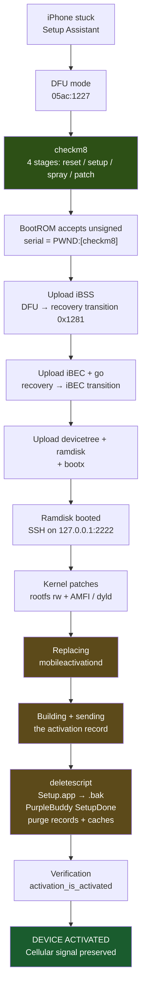
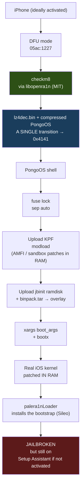
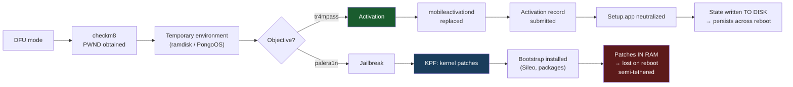
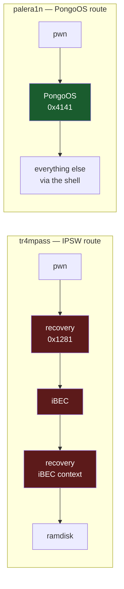

# tr4mpass vs palera1n — two routes, two objectives

> Part of the [documentation index](README.md).

> **Note**: this document compares the **technical routes** of two tools that
> share the same entry point (checkm8) but pursue different objectives. It was
> written after the validation of the checkm8 stage on Apple Silicon Macs over
> direct USB-C → Lightning (see
> [`apple-silicon-usbc/`](apple-silicon-usbc/README.md),
> experiment E19).

---

## 1. The objective, stated unambiguously

An iPhone stuck on the **Setup Assistant** is unusable: no access to the home
screen, no network, no usable SIM. Unlocking it requires **four** distinct
things:

| # | What must be achieved | Why it is necessary |
|---|---|---|
| 1 | The BootROM accepts unsigned code | Without it, no third-party code runs on the device |
| 2 | A temporary execution environment (ramdisk) | Lets you write to the file system |
| 3 | Activation recorded on the `mobileactivationd` side | Otherwise iOS stays on the Setup screen |
| 4 | Setup Assistant neutralized (`Setup.app` + PurpleBuddy) | Otherwise it restarts at boot |

**"Signal preserved"** means step 3 is done *cleanly*: the baseband stays
paired, the IMEI/MEID is recognized, calls and data work. A botched activation
gives you a device that boots but stays on "Searching…" with no cellular
network.

That is what tr4mpass aims for. **palera1n does not aim for that** — it aims
for a *jailbreak* (running unsigned code permanently, installing packages).
Both need steps 1 and 2, then they diverge completely.

---

## 2. The tr4mpass route — Path A (A5 → A11)

**USB transitions: 3** (DFU → recovery → iBEC → bootx). Each one is a potential
point of fragility on Apple Silicon USB-C ports — this is exactly what palera1n
documents as problematic downstream of the pwn.

**What produces persistence**: the files written to the file system
(`mobileactivationd` replaced, `Setup.app` renamed, plists). The device stays
activated after reboot, because the state is **on disk**.

---

## 3. The palera1n route (v3.0.0-beta.3)

**USB transitions: 1** (DFU → PongoOS). That is its real technical advantage on
Apple Silicon: a single switchover, the same mechanism that already works.

**What produces "persistence"**: two layers.
- The kernel patches live **in RAM only** → lost on every reboot (hence the
  *semi-tethered* nature).
- The bootstrap (Sileo, tweaks) lives on a 2nd APFS volume ("fakefs") or
  `/var/jb` → persists.

**What does not persist**: activation. palera1n never touches it.

---

## 4. Where the two routes separate

Both consume the same steps 1 and 2. **Everything that follows diverges.**
An unactivated device remains unactivated after palera1n, whatever the success
of its jailbreak.

---

## 5. Comparison table — what one does, what the other does not

### 5.1 Capabilities

| Capability | tr4mpass (Path A) | palera1n |
|---|:---:|:---:|
| Exploit checkm8 (A5 → A11) | ✅ | ✅ |
| Obtain `PWND:[checkm8]` | ✅ | ✅ |
| Boot an unsigned environment | ✅ iOS ramdisk | ✅ PongoOS |
| Patch the kernel | ✅ (rootfs rw + AMFI/dyld) | ✅ (KPF: AMFI, sandbox) |
| **Submit an activation record** | ✅ `mobileactivation_activate` | ❌ **never** |
| **Replace `mobileactivationd`** | ✅ backup + SCP + chmod/chown + verification | ❌ **never** |
| **Neutralize `Setup.app`** | ✅ renamed to `.bak` (reversible) | ❌ **never** |
| **Mark PurpleBuddy `SetupDone`** | ✅ plist write | ❌ **never** |
| **Purge activation records** | ✅ | ❌ **never** |
| **Verify the final activation state** | ✅ `activation_is_activated` | ❌ **never** |
| **"Signal preserved" logic** | ✅ GSM / CDMA / dual detection | ❌ **never** |
| Install a package manager | ❌ | ✅ Sileo via bootstrap |
| Install tweaks / dylibs | ❌ | ✅ |
| Support A12+ (Path B) | ✅ | ❌ (checkm8 stops at A11) |
| Work on an **already activated** device | ✅ | ✅ |
| Work on a **non-activated** device | ✅ (that is the goal) | ⚠️ jailbreak yes, activation no |

### 5.2 Transport and reliability (Apple Silicon Mac, direct USB-C)

| Criterion | tr4mpass (Path A) | palera1n |
|---|---|---|
| Promoted USB backend | Direct IOKit (`DeviceRequestTO`) | IOKit (libopenra1n) |
| libusb backend | ✅ (Linux/Windows) | ✅ (alternative build) |
| **USB transitions after the pwn** | **3** | **1** |
| Exposure to the M-series USB-C bug | high (documented area) | low |
| Reboot required after the pwn | no | no |
| State after reboot | ⚠️ depends on the disk write | semi-tethered (restart the tool) |
| Requires an IPSW | ✅ yes (iBSS/iBEC/devicetree/ramdisk) | ❌ no (embedded payloads) |
| Requires pongoOS payloads | ❌ no | ✅ yes (CI artifacts) |
| License | — | MIT (libopenra1n) |

### 5.3 Persistence layers

| Layer | tr4mpass | palera1n |
|---|---|---|
| Kernel patches | applied from the ramdisk, **written to disk** | **RAM only** |
| `mobileactivationd` | ✅ replaced on `/mnt1/usr/libexec/` | — |
| Bootstrap / packages | — | 2nd APFS volume or `/var/jb` |
| User-visible apps | — | palera1nLoader in `/Applications` |
| Survives reboot | ✅ yes (disk state) | ❌ no for the kernel |

### 5.4 Validation status (honesty)

| Element | tr4mpass | palera1n |
|---|---|---|
| checkm8 on this machine | ✅ **proven E19** (`PWND:[checkm8]`) | ✅ proven E16 |
| Steps 3 through 8 (activation) | ⚠️ **written, never executed** | — (do not exist) |
| Full jailbreak | — | ✅ tool in production |
| Tests | 62/62 unit | — |

> **This is the most important point of this document.** tr4mpass's activation
> code (`src/bypass/`, `src/activation/`, ~2980 lines) is complete but has
> **never run on a device**, because checkm8 was blocking everything upstream.
> The E19 validation lifts that blockage for the first time. palera1n,
> conversely, is battle-tested — but does not know how to activate.

---

## 6. What there really is to borrow from palera1n

A single element, and it is not business logic code:

**The single-transition transport.** The idea of having the stage 4 payload
carried by a complete environment (compressed PongoOS + `lz4dec.bin`) rather
than by a small shellcode, so that the device switches directly into an
exploitable mode without going back through recovery.

The three red steps are three chances to lose the device on an Apple Silicon
USB-C port. The green step is a single chance.

**But**: adopting this route means giving up the iOS ramdisk extracted from an
IPSW, and therefore finding an alternative ramdisk containing the activation
tools (`mobileactivationd`, AFC, SSH…) — that is a project, not a port.

**Decision**: only do it if the iBSS transition test fails.
If the 3 transitions pass, the IPSW route (already fully written) remains the
shortest.

---

## 7. Summary in one sentence

> **palera1n** unlocks the inside of the system but leaves the front door
> closed; **tr4mpass** opens the front door, and still has to prove that it
> can do so end to end.

---

## See also

- [`apple-silicon-usbc/`](apple-silicon-usbc/README.md) — complete E0 → E20b log
- [`README.md`](README.md) — tr4mpass user documentation
- [palera1n](https://github.com/palera1n/palera1n) — upstream repository (`v3.0.0-beta.3` branch analyzed)
