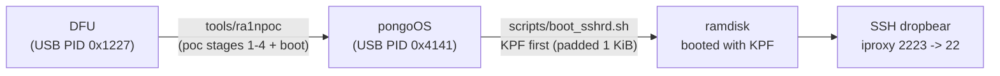
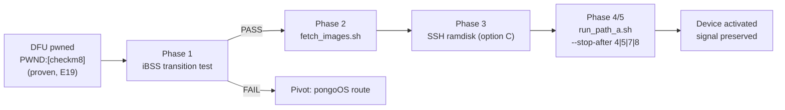

# Pipeline Operations Guide — from PWND to activated

> Part of the [documentation index](README.md).

> **TLDR** — checkm8 is proven on this machine (E19). This guide documents
> every script and code path that takes the device the rest of the way:
> images → ramdisk → kernel patches → activation. Run commands from the
> repo root. All state lives in `~/.cache/tr4mpass` (never `/tmp`).
>
> Sources: links inline. Anything we could not verify is flagged **UNVERIFIED**.

---

## 0. Current proven route (E64+ — what actually runs today)

The Phase 1–5 iBSS-transition pipeline below is **legacy** (kept for
context; the pivot to pongoOS happened during E24–E28). The route that
pwns device and boots the SSH ramdisk *reliably* today, end to end:



| Stage | What | Tool/command | Proof marker |
|---|---|---|---|
| 0 | Device in DFU | manual: Power+Home 10 s → black → release Power, hold Home ~5 s | `ioreg -p IOUSB` shows `4647` (0x1227) |
| 1–4 | checkm8 exploit stages (reset → setup → spray → overwrite, gaster-style reset between every stage; E19 proof `PWND:[checkm8]`). Two ways to run them: our C worker `./tr4mpass -v` (`src/exploit/checkm8.c`), **or** `tools/ra1npoc`, whose bundled poc does the same job and continues straight into the next stage — **today's canonical chain uses ra1npoc** | `~/.cache/tr4mpass/tools/ra1npoc` (built by `scripts/build_ra1npoc.sh`) | phone screen stays black; then pongo appears |
| 5 | pongoOS shell | ra1npoc output end | `ioreg` shows `16705` (0x4141) |
| 6 | KPF loaded (kernel patches for Ramsey/MAC-etc freeboot) | `scripts/boot_sshrd.sh` uploads the **pre-padded** KPF `kpf_checkra1n_1k.bin` (88 064 B — padded to a 1 KiB multiple, *never* 16 KiB: pongoOS finishes a transfer on a *short* final OUT chunk, so full alignment kills the terminator and `modload` hangs on "short read"; see journal E60–E64) → `cmd modload` | `|KPF_OK|` |
| 7 | SSH ramdisk boots | same script: ramdisk upload → `cmd ramdisk` → `xargs rootdev=md0 rd=md0 -v wdt=-1 trm_default=0` → `xfb` → `bootx` | `|RD_OK|` `|BOOTX_SENT|` |
| 8 | Shell access | same script probes, or manually: `iproxy 2223 22` + `scripts/ssh_expect22.sh 'echo SHELL_OK'` (sftp pulls: `scripts/sftp_expect.sh`) | `TRY1: SHELL_OK` |

Day-to-day file surgery convention (Embedding/renaming on System volume):
`cp` backup → `mv` → `sync` (rc=0) → clean `umount` (rc=0) → reboot —
**one variable per freeboot run** (the E65–E67 boot matrix in the
journal is why).

---

## 1. The one picture *(legacy Phase 1–5 pipeline — superseded by route 0 above)*



Full plan with gates: [`execution-plan.md`](execution-plan.md).
Route comparison vs palera1n:
[`palera1n-comparison.md`](palera1n-comparison.md).

---

## 2. Scripts (all in `scripts/`, no agents needed)

Shared state: every script sources `scripts/lib.sh`, which owns
`TR4MPASS_STATE_DIR` (default `~/.cache/tr4mpass`, override via env).
`state_dir()` and `log_dir()` create-and-print; `require_env_var` and
`require_file` fail fast with a clear message.

| Script | What it does | Verified how |
|---|---|---|
| `lib.sh` | State-dir contract (single source of truth) | contract used by all scripts |
| `detect_ios.sh` | Waits for normal-mode device, records iOS version/build/model into `$(state_dir)` | device run pending (Phase 1) |
| `ipsw_pull.py` | Pulls ONE file from a remote IPSW via HTTP Range (ZIP central directory) — ~300 KB instead of a 2+ GB download. Subcommands: `list` / `url-for` / `probe` / `fetch` | probed 4 real IPSWs (9.0→9.3.5) |
| `ramdisk_test_ibss.sh` | **Phase 1 gate**: uploads iBSS to pwned DFU, watches PID 0x1227→0x1281 | not yet run on device |
| `fetch_images.sh` | **Phase 2**: resolves the IPSW by build and extracts the iBSS/iBEC/DeviceTree/RestoreRamDisk/trustcache entries for the detected ProductType/board via `BuildManifest.plist`; writes `$(state_dir)/images/env.sh` | end-to-end on real IPSWs (iOS 9 and 15); entries resolved from the manifest |
| `run_path_a.sh` | **Phase 4/5**: validates env, exports `TR4MPASS_STOP_AFTER`, runs `./tr4mpass -v`, tees log, prints final serial | stub-tested arg/exit paths |
| `build_ramdisk_ssh.sh` | **Phase 3**: capability gate for an SSH-ramdisk builder; fails with exact upgrade command today | tool capabilities verified from upstream sources (below) |
| `build_ra1npoc.sh` | Builds `ra1npoc` (DFU pwn + pongoOS shell), `pongoterm`, `pongo_upload` into `$(state_dir)/tools/` | in daily use E63+ |
| `build_ssh_rd.sh` | Slim 44 MiB SSH ramdisk builder (`TR4MPASS_SKIP_AFC=1` skips the AppleFSCompression embed for revert-only boots) | built & booted E32–E64 |
| `pongo_load_ramdisk.sh` | Drives a LIVE pongoOS shell (upload ramdisk, optional `--kpf`, boot-args, boot) | superseded for one-shot boots by `boot_sshrd.sh` |
| `boot_sshrd.sh` | **Canonical current boot**: DFU check → `ra1npoc` → padded-KPF-first → ramdisk → boot-args → `bootx` → SSH probes; marker-monitored | proven E64–E68 (`KPF_OK/RD_OK/BOOTX_SENT/TRY1: SHELL_OK` first-try in 4 consecutive device runs) |
| `ssh_expect22.sh` | One command over SSH into the booted ramdisk (password expect, port 2223) | in daily use E47+ |
| `sftp_expect.sh` | One sftp `get`/`ls` into the booted ramdisk (forensics pulls) | used E68 |

---

## 3. Code changes that make re-runs safe

| Change | Where | Why |
|---|---|---|
| **Skip-if-pwned on macOS** | `src/exploit/checkm8.c` (`checkm8_exploit`) | Second run on a pwned device used to re-run all 4 exploit stages against pwned DFU → guaranteed fail. Now: macOS closes the libusb handle (no USB traffic), reads serial via IOKit (E19-proven), returns 0 if `PWND:` present. Linux verifies on the open handle as before. |
| **Staged execution** | `src/bypass/path_a.c` + `env_config.{h,c}` | `TR4MPASS_STOP_AFTER=N` (1–8, default 8) stops after step N with success. Lets us prove steps 3–4 (ramdisk+patches) before touching activation. Single source of truth for the name: `TR4MPASS_ENV_STOP_AFTER` in `include/util/env_config.h`. |
| `TR4MPASS_STOP_AFTER` registry entry | `src/util/env_config.c` | kind `ENV_KIND_PLAIN` (same as `SSH_PORT`) — no new kind. |

---

## 4. Workflow, concretely

```sh
# 0. build once
make

# 1. Device in normal mode first (it boots iOS after unplug/replug):
scripts/detect_ios.sh                 # waits, writes $(state_dir)/ios_*.txt

# 2. Put device in DFU, then pwn it:
./tr4mpass -v                          # E19 flow, ends with PWND:[checkm8]

# 3. Pull the images for the detected build:
scripts/fetch_images.sh
source ~/.cache/tr4mpass/images/env.sh

# 4. Phase 1 gate — does the USB-C transition survive?
scripts/ramdisk_test_ibss.sh           # PASS => route confirmed

# 5. Staged runs (device back in DFU, re-pwn if needed):
scripts/run_path_a.sh --stop-after 4   # pwn+verify+ramdisk+patches, no activation
scripts/run_path_a.sh --stop-after 5   # + mobileactivationd replacement (needs TR4MPASS_PATCHED_MAD)
scripts/run_path_a.sh --stop-after 7   # + activation record + deletescript
scripts/run_path_a.sh                  # full [1/8]..[8/8]
```

Logs land in `~/.cache/tr4mpass/logs/` (timestamped).

---

## 5. Tooling decisions — existing tools first (user directive)

Verified 2026-11-01 from upstream sources; the verification trail is
documented in each script's header.

| Need | Existing tool | Verdict |
|---|---|---|
| Download/extract IPSW | [blacktop/ipsw](https://github.com/blacktop/ipsw) (MIT) — `brew install blacktop/tap/ipsw` | ✅ use it ([docs](https://blacktop.github.io/ipsw)) |
| Build SSH ramdisk | `ipsw ssh` | ❌ **is an SSH client, not a builder** ([source](https://github.com/blacktop/ipsw/blob/master/cmd/ipsw/cmd/ssh/ssh.go), [docs](https://blacktop.github.io/ipsw/docs/cli/ipsw/ssh/ssh)) |
| Mount stock ramdisk | `ipsw mount rdisk IPSW --ident Erase [--key K | --lookup]` ([docs](https://blacktop.github.io/ipsw/docs/cli/ipsw/mount)) | ✅ verified |
| Prebuilt SSH ramdisk | dora2-iOS | ❌ **account inactive, releases 404** — UNVERIFIED→dead |
| Patch iBEC/iBoot/dyld | [iBoot64Patcher](https://github.com/Tihmstar/iBoot64Patcher), [img4tool](https://github.com/Tihmstar/img4tool), [iExtractor](https://github.com/malus-security/iextractor) | ✅ known (README References) |
| Activate ([6/8]) | [ideviceactivation](https://github.com/libimobiledevice/libideviceactivation) `activate` — *"complete activation and deactivation process"* | ✅ candidate to replace our C step for the first device run (LGPL2.1/GPL3 CLI — mind linking) |
| deletescript ([7/8]) | none known | ❌ stays tr4mpass code |

**Consequence**: Phase 3 option C is the only live path (manual pipeline:
`ipsw mount rdisk` → inject dropbear + tools → iBoot64Patcher → img4tool).
`build_ramdisk_ssh.sh` keeps a runtime probe so a future `ipsw ssh ramdisk`
is adopted automatically when it exists.

---

## 6. Honest risks and open blockers

| Risk / blocker | Status |
|---|---|
| `TR4MPASS_PATCHED_MAD` (patched mobileactivationd) | **OPEN** — not in repo, not in IPSW, no known prebuilt (dora2 dead). Options: build from libideviceactivation/go-ios sources, or obtain externally. Decision needed before Phase 4 stage B. |
| USB-C transitions post-pwn (Phase 1) | unmeasured until `ramdisk_test_ibss.sh` runs |
| SSH ramdisk decrypt/patch chain | multi-tool, untested on-device; WKEY lookup via `ipsw` expected but **UNVERIFIED** on A9 |
| `ideviceactivation` compatibility with old iOS | **UNVERIFIED** for iOS 9–12; test before relying on it |
| `fetch_images.sh` on iOS 15 IPSWs | entry names verified, full fetch not exercised (5 GB OS dmg avoided by design) |
| `checkm8_verify_pwned` macOS fallback log | fixed to return early; no misleading usbipd warning on fresh runs |

---

## 7. State layout

```
~/.cache/tr4mpass/          (override: TR4MPASS_STATE_DIR)
├── ios_version.txt         from detect_ios.sh
├── ios_build.txt
├── ios_model.txt
├── images/                 from fetch_images.sh
│   ├── env.sh              source this before run_path_a.sh
│   ├── iBSS.<board>.RELEASE.im4p
│   ├── iBSS.<board>.RELEASE.im4p    (alternate board)
│   ├── iBEC.<board>.RELEASE.im4p
│   ├── DeviceTree.<board>.im4p
│   ├── <ramdisk>.dmg [+ .trustcache on iOS 14+]
│   ├── kpf_checkra1n_1k.bin        CURRENT boot KPF (88 064 B, 1 KiB-
│   │                               multiple pad: see section 0 / E60-E64)
│   ├── kpf_checkra1n_pad.bin       negative-test artifact (16 KiB pad
│   │                               kills the short-chunk terminator)
│   ├── kpf_checkra1n.bin           KPF extracted from checkra1n blob
│   └── ramdisk_ssh_raw.hfs         CURRENT SSH ramdisk (50 331 648 B,
│                                   built by build_ssh_rd.sh)
├── tools/                  built binaries (ra1npoc, pongo_upload,
│                           pongoterm, ...) built by build_ra1npoc.sh
└── logs/                   timestamped run logs
```

---

## 8. Sources

- [libideviceactivation README](https://github.com/libimobiledevice/libideviceactivation) — activation/deactivation CLI (fetched 2026-11-01)
- [blacktop/ipsw](https://github.com/blacktop/ipsw) + [CLI docs](https://blacktop.github.io/ipsw) — download/mount/ssh capabilities (fetched 2026-11-01)
- [ipsw ssh source](https://github.com/blacktop/ipsw/blob/master/cmd/ipsw/cmd/ssh/ssh.go) — proves it is a client wrapper
- [ipsw mount docs](https://blacktop.github.io/ipsw/docs/cli/ipsw/mount) — rdisk mounting
- dora2-iOS GitHub — org shows `public_repos: 0`; releases 404 (checked 2026-11-01)
- Internal: E19 proof, script verification logs — [`apple-silicon-usbc/`](apple-silicon-usbc/README.md)
